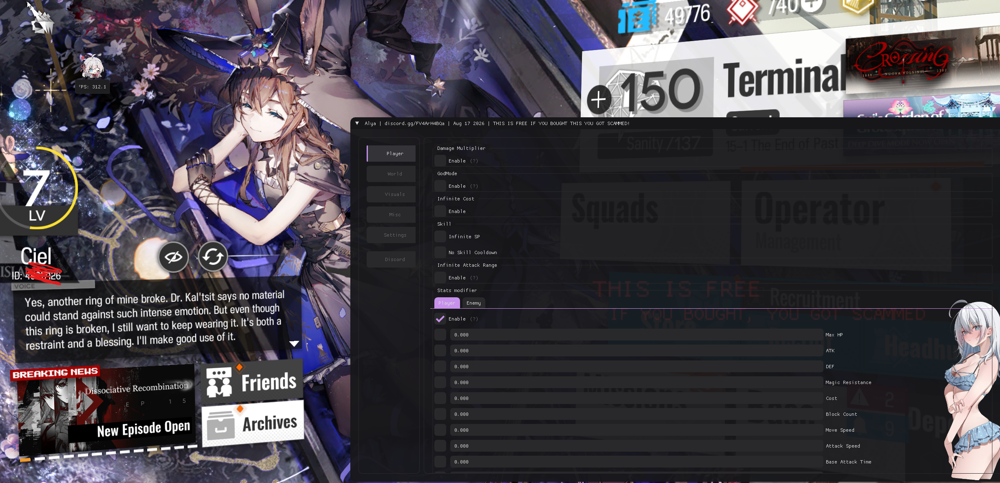
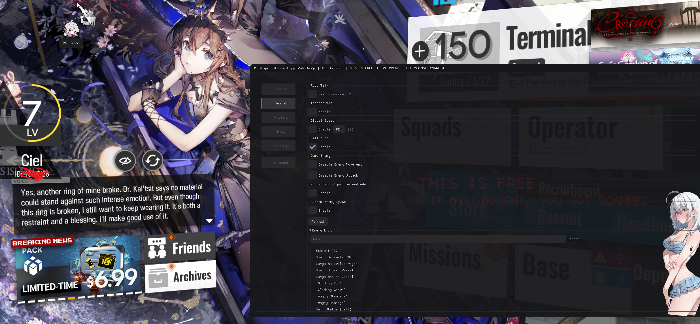
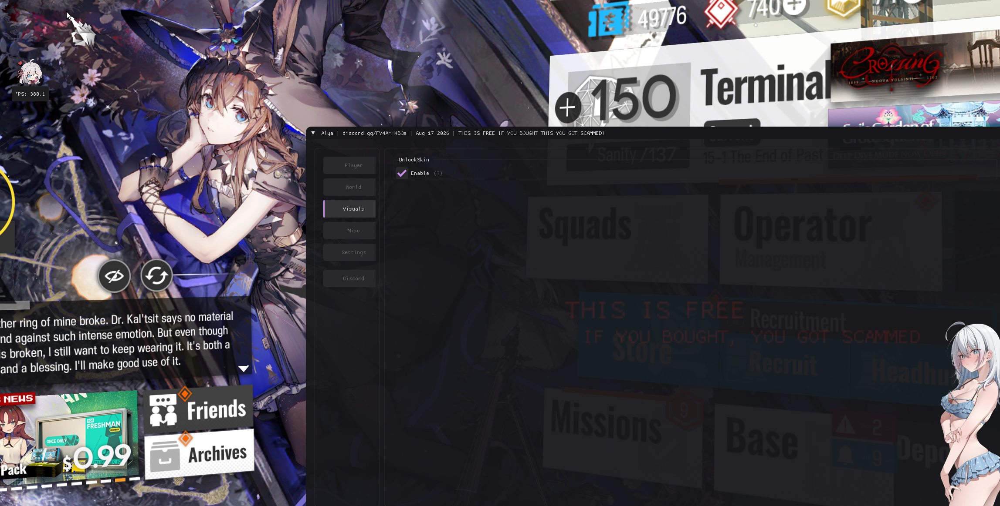

# Alya — Arknights

> **Mirrored copy.** Original source: <https://github.com/0xCiel/Alya-Arknights>
> All credit to **0xCiel** and the Alya project — this repository does not own or maintain it.

> **Download:** [release `0.1.7`](https://github.com/0xHasan97/project-cheats/releases/tag/0.1.7) — `Release.rar`, released the same way as the upstream build.

If you're interested for Endfield, join the Discord: <https://discord.gg/FV4ArH4BQa>

## Features

> **Player**
* Damage Multiplier
* God Mode
* Infinite Cost
* Stats Modifier (Player, Enemy)
* Infinite SP
* No Skill Cooldown
* Infinite Attack Range

> **World**
* Instant Win
* Global Speed
* Kill Aura
* Dumb Enemy
* Skip Dialogues
* Protection Objective Godmode
* Custom Enemy Spawn

> **Visuals**
* Unlock Skins

## Screenshots

## Status

**WIP**

---

## Credits

- **0xCiel** — author — <https://github.com/0xCiel>
- **Alya Discord** — <https://discord.gg/9gW7MWsWnH>
- **Endfield Discord** — <https://discord.gg/FV4ArH4BQa>

For archival/mirroring purposes only. All rights belong to the original author.
