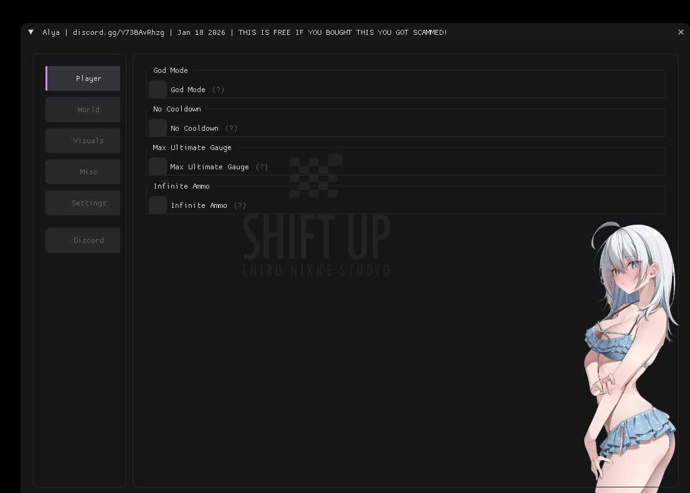
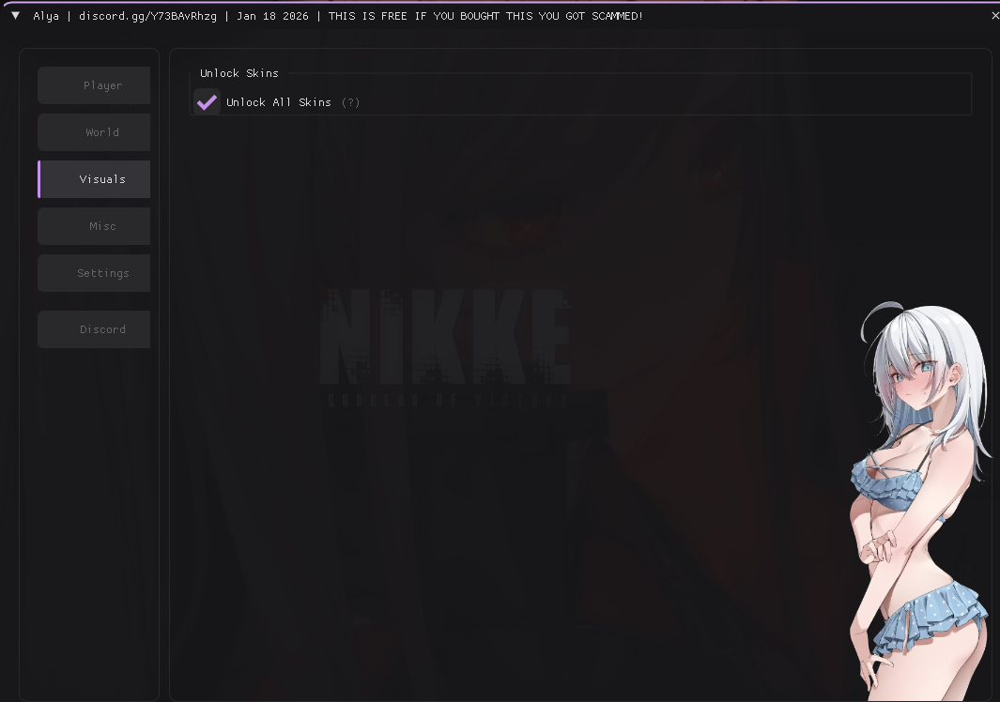

# Alya — NIKKE: Goddess of Victory

> **Mirrored copy.** Original source: <https://github.com/0xCiel/Alya-NIKKE>
> All credit to **0xCiel** and the Alya project — this repository does not own or maintain it.

> **Download:** [release `0.1.8`](https://github.com/0xHasan97/project-cheats/releases/tag/0.1.8) — `Release.rar` (verified against the upstream SHA-256 digest) and `SHA256SUMS.txt`, released the same way as the upstream build.

## Open Menu

**Insert**

## Features

### Player
- God Mode
- No Cooldown
- Max Ultimate Gauge
- Infinite Ammo
- Damage Multiplier

### World
- Global Speed

### Visual
- Unlock All Skins

## Screenshots

---

## Credits

- **0xCiel** — author — <https://github.com/0xCiel>
- **Alya Discord** — <https://discord.gg/9gW7MWsWnH>

For archival/mirroring purposes only. All rights belong to the original author.
