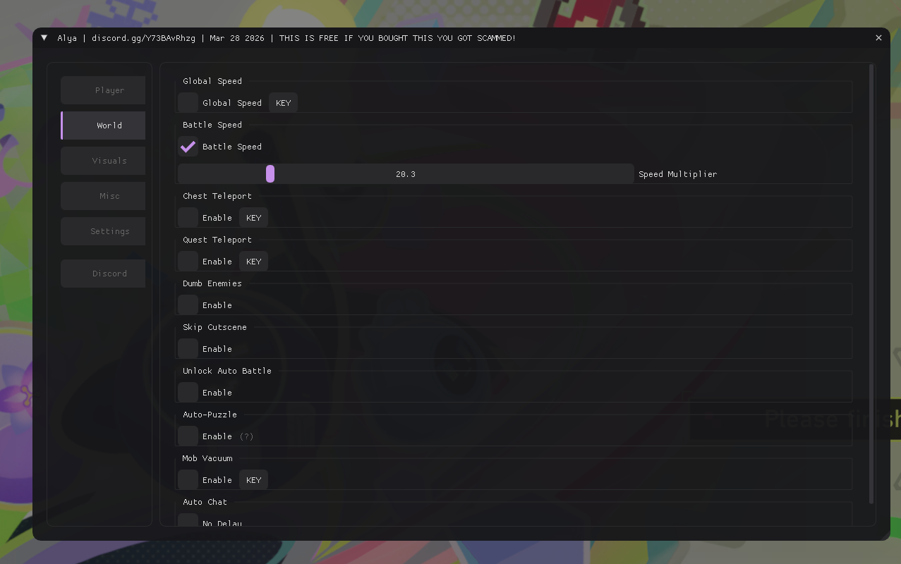

# Alya — Honkai: Star Rail

> **Mirrored copy.** Original source: <https://github.com/0xCiel/Alya-StarRail>
> All credit to **0xCiel** and the Alya project — this repository does not own or maintain it.

> **Download:** [`Alya-StarRail-v0.2.8`](https://github.com/0xHasan97/project-cheats/releases/tag/Alya-StarRail-v0.2.8) — `Release.rar`, released the same way as the upstream build.

## Open Menu

**Insert**

## Features

### Player
- Noclip
- WalkSpeed
- Infinite Technique Points

### World
- Global Speed
- Battle Speed
- Chest Teleport
- Chest Vacuum
- Quest Teleport
- Dumb Enemies
- Skip Cutscenes
- Unlock Auto Battle
- Mob Vacuum
- Auto Chat
- Auto Skip Dialogues

### Visual
- Skin Unlocker
- UID Editor
- Peeking
- ESP
- Free Camera
- Hide UI
- Max Eidolon

### Misc
- Damage Leaderboard

## Screenshots

---

## Credits

- **0xCiel** — author — <https://github.com/0xCiel>
- **Alya Discord** — <https://discord.gg/9gW7MWsWnH>

For archival/mirroring purposes only. All rights belong to the original author.
