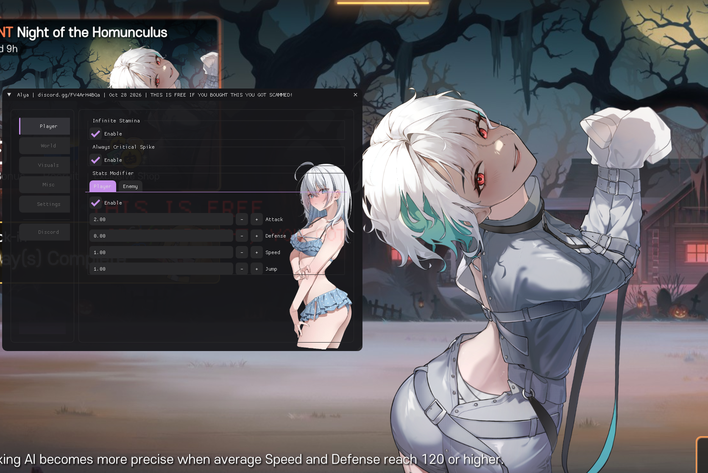
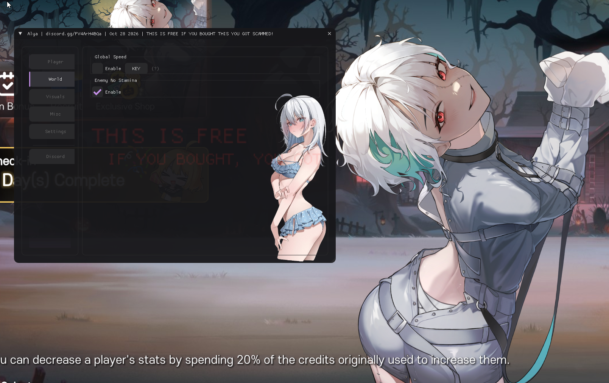
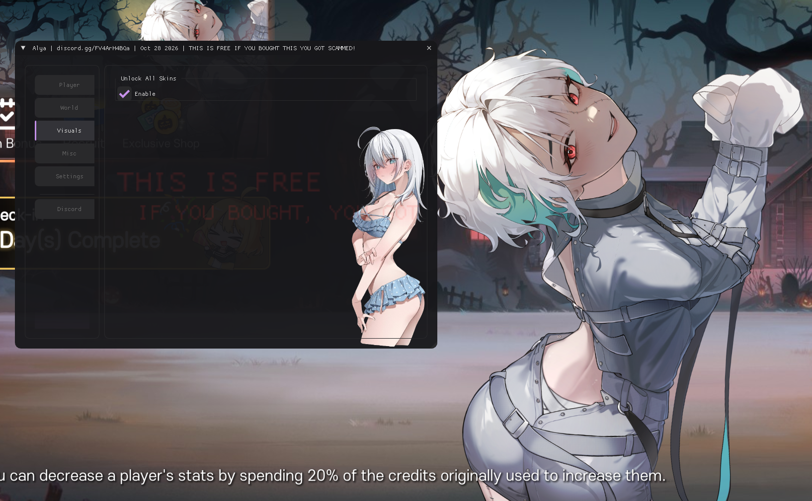

# Alya — The Spike Cross

> **Mirrored copy.** Original source: <https://github.com/0xCiel/Alya-TheSpikeCross>
> All credit to **0xCiel** and the Alya project — this repository does not own or maintain it.

> **Download:** [Alya — The Spike Cross release](https://github.com/0xHasan97/project-cheats/releases/tag/alya-thespikecross-v1.0) — documentation folder bundle plus `SHA256SUMS.txt`.

Only for the Steam version.

## Open Menu

**Insert**

## Features

**Player**
* Infinite Stamina
* Always Critical Spike
* Stats Modifier: Player && Enemy

**World**
* Global Speed
* Enemy No Stamina

**Visuals**
* Unlock All Skins

## Screenshots

---

## Credits

- **0xCiel** — author — <https://github.com/0xCiel>
- **Alya Discord** — <https://discord.gg/9gW7MWsWnH>

For archival/mirroring purposes only. All rights belong to the original author.
