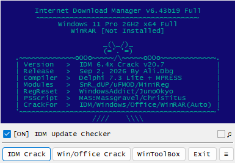

# IDM 6.4x Crack v20.7 — by Ali.Dbg

> **Mirrored copy.** Author: **Ali.Dbg**. This repository does not own or maintain this tool.

Multi-purpose activation tool with a menu for **Internet Download Manager**, **Windows / Office** and **WinRAR**.

> **Download:** [`IDM-Crack-v20.7`](https://github.com/0xHasan97/project-cheats/releases/tag/IDM-Crack-v20.7) — `IDM-6.4x-Crack-v20.7.zip`.

## Package info

| Field | Value |
| --- | --- |
| Tool version | v20.7 |
| Tool release date | Sep 2, 2026 |
| File | `IDM_6.4x_Crack_v20.7.exe` |
| Size | 56,832 bytes (packed zip: 51,902 bytes) |
| SHA-256 (exe) | `8eaa420d3c8e7aa450d79f8635c2de5c8f8038a3d3ee3775a3cb7e411d2181fc` |
| SHA-256 (zip) | `1c3734134d431a309db3fb9dfd38b8d63c4401580c8ab7ae691d4b58b2933df5` |
| Compiler | Delphi 7.3 Lite + MPRESS |
| Signature | Not signed |

## Menu

| Button | Target |
| --- | --- |
| **IDM Crack** | Internet Download Manager 6.4x |
| **Win/Office Crack** | Windows and Microsoft Office activation |
| **WinToolBox** | Windows utilities |
| **IDM Update Checker** | toggle, on by default |

The status panel reports what it detects on the machine — in the screenshot above: Internet Download Manager v6.43b19, Windows 11 Pro 26H2 x64, WinRAR not installed.

## Usage

1. Run `IDM_6.4x_Crack_v20.7.exe`.
2. Check the detected versions in the status panel.
3. Pick **IDM Crack** or **Win/Office Crack**.

## Build info (from the tool's own panel)

`Modules: SnR_dUP / uFMOD / MiniReg` · `RegReset: WindowsAddict / JunoOkyo` · `PSScript: MAS (massgravel / ChrisTitus)` · `CrackFor: IDM / Windows / Office / WinRAR (Auto)`

## Warnings

- The executable is **unsigned and MPRESS-packed**, so Windows Defender and SmartScreen will flag it. That is expected for this kind of tool, not proof of tampering — but it also means nothing here is verified.
- The tool disables IDM's update checker and patches activation, so it modifies installed software.
- It activates **paid commercial products**. That is copyright circumvention and is illegal in many jurisdictions; hosting it can also breach GitHub's terms. Use and mirror at your own risk.

---

## Credits

- **Ali.Dbg** — author of the crack tool
- **WindowsAddict / JunoOkyo** — RegReset component
- **MAS** (massgravel / ChrisTitus) — PowerShell script component

For archival/mirroring purposes only. All rights belong to the original author.