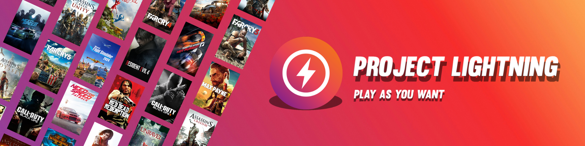

# Project Lightning ⚡

> **Mirrored copy.** Original source: <https://github.com/LightnigFast/Project-Lightning>
> Official site: <https://project-lightning-web.vercel.app/>
> All credit to **LightningFast** — this repository does not own or maintain this software.

All-in-one game library manager, launcher and download platform for Windows and Linux.

> **Download:** [`Project-Lightning-v5.1.0.0`](https://github.com/0xHasan97/project-cheats/releases/tag/Project-Lightning-v5.1.0.0) — Windows installer and Linux AppImage.

## Package info

| Field | Windows | Linux |
| --- | --- | --- |
| Tool version | 5.1.0.0 | 5.1.0.0 |
| File | `ProjectLightningInstaller-v5.exe` | `ProjectLightningInstaller.AppImage` |
| Size | 392,560,887 bytes (374.4 MB) | 162,494,495 bytes (155.0 MB) |
| Requires admin | No | No |
| SHA-256 | `ac75c6fe44ab638a4101f3378a50378e5e3f2af7026b4c735a44867d52d823f5` | `bce76e031bd360a1d0d60bf851256275aaa83be73e21ea8ae349b82fbb567382` |

## Install

**Windows** — run the installer. It deploys to `%localappdata%` and needs no administrator rights.

**Linux** — `chmod +x ProjectLightningInstaller.AppImage && ./ProjectLightningInstaller.AppImage`

## Features

**Game Library** — library management · playtime tracking · Lightning Launcher · automatic artwork · Steam CDN & Lightning Nexus integration · custom `lightning://` protocol · desktop shortcuts

**Lightning Nexus** — browse the catalog of PC and console games with screenshots, release dates, genres and publishers, and add titles straight to your library

**Download Manager** — GoFile · Buzzheavier · MegaDB · Rootz · WebTorrent (P2P), with a download queue, pause/resume, multi-part downloads, automatic extraction (ZIP / RAR / 7Z) and password detection

**Built-in Tools** — LightningTools (Steam library integration, manifests, Lua support, library sync) · Bypass section for fixes and compatibility patches · OnlineFix auto-install

**Extras** — DualShock 4 / DualSense / Xbox controller support · English, Spanish, French, German and Portuguese interface · Windows and Linux builds

## Release history

- **v5.1.0.0** — Nov 25, 2026 — V5 major update: custom library categories, redesigned hero banner, `.bat` executable support, dual executable paths, Nexus and LightningTools improvements
- **v5.0.11.0** — Sep 15, 2026 — "No connection error" fixed for games installed through LightningTools without manifests
- **v5.0.10.0** — Sep 9, 2026 — manifest toggle added in settings
- **v5.0.9.0** — Sep 1, 2026 — Cloudflare token error fixed, AnkerGames links restored, IGGAMES extraction fixed

## License notice

Project Lightning is **proprietary**. Its upstream license reserves all rights and prohibits redistribution of the software without the author's permission. This folder exists for archival and reference only — it will be removed on request from the author.

---

## Credits

- **LightningFast** — author — <https://github.com/LightnigFast>
- **Website** — <https://project-lightning-web.vercel.app/>
- **Discord** — <https://discord.gg/JBB2pTNTqK>

For archival/mirroring purposes only. All rights belong to the original author.